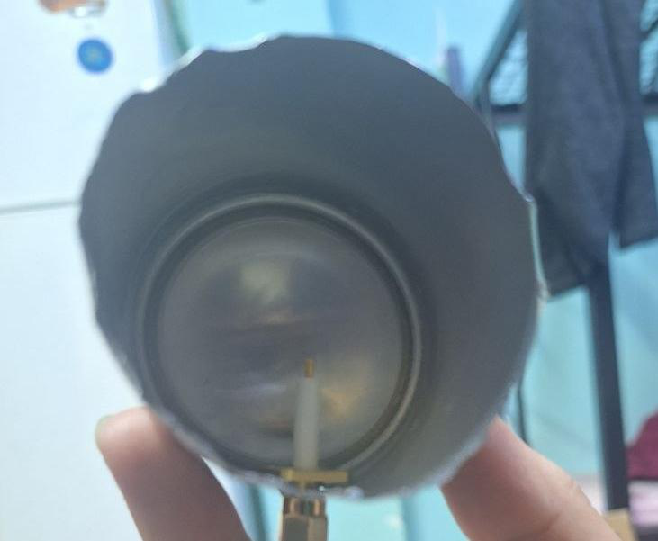
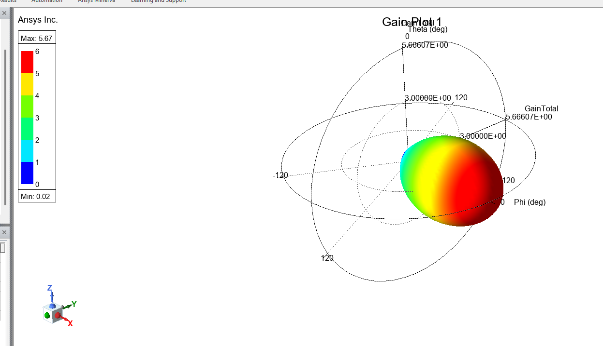
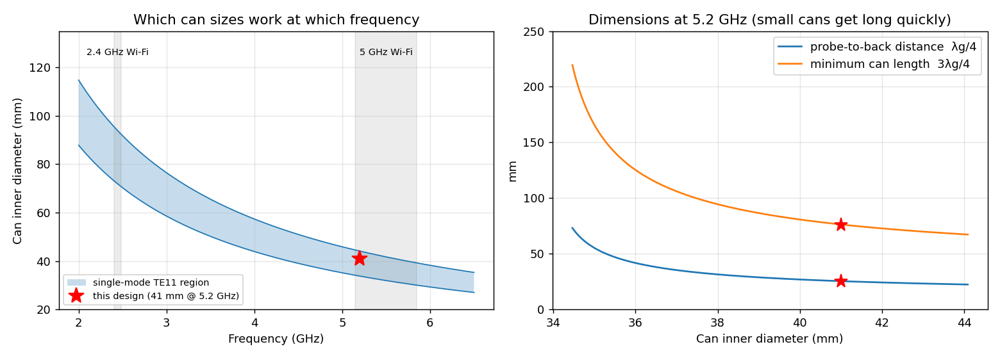
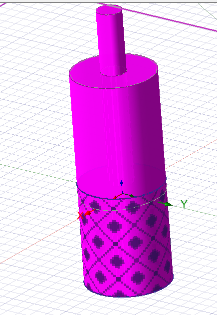
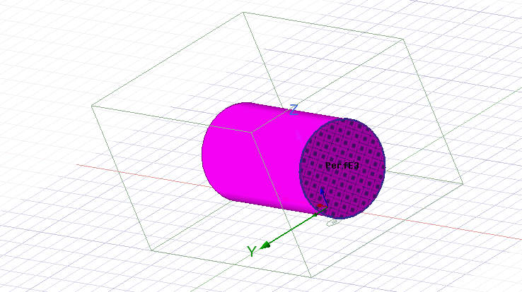
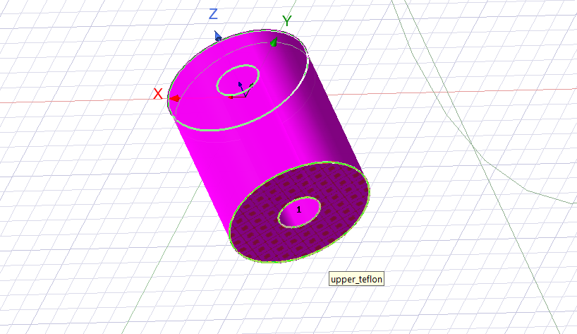
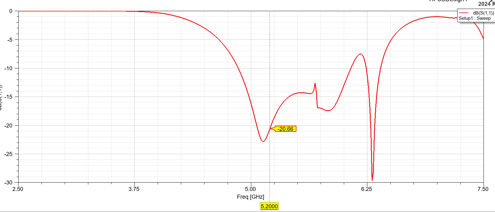
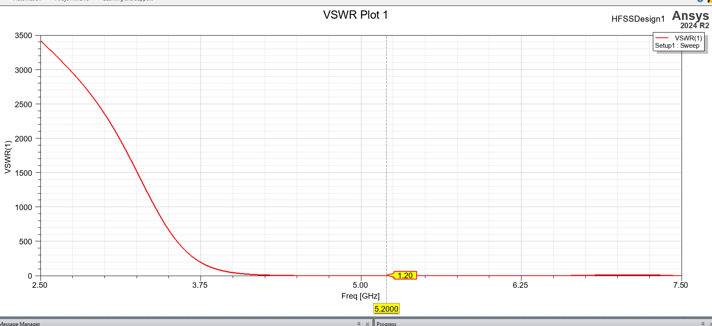
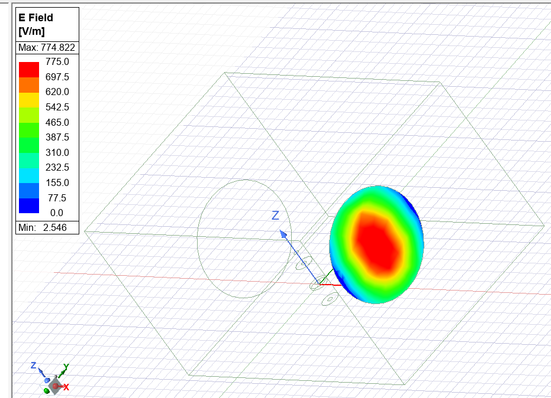
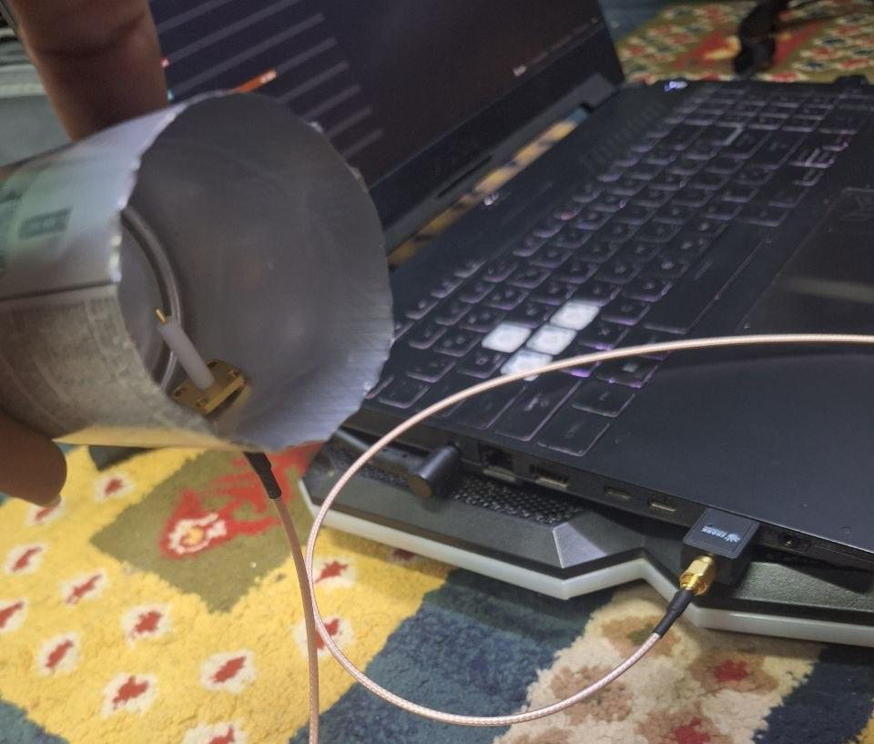

# 5 GHz Wi-Fi "Cantenna": Circular-Waveguide Antenna

This is a directional Wi-Fi antenna made from a metal can. It was designed with waveguide theory, simulated in **Ansys HFSS**, built, and tested on the university's 5.2 GHz Wi-Fi network. In a line-of-sight test the received signal improved by **5 dB** compared with the laptop's built-in antenna.

> **Course:** Antenna Lab, final project, Amirkabir University of Technology.

| Built antenna | Simulated gain pattern (HFSS) |
|---|---|
|  |  |

## How it works
A can is a short-circuited **circular waveguide**. A quarter-wave monopole probe excites the dominant **TE11** mode, and the open end radiates as an aperture antenna. Three conditions set the design:

1. **Single-mode operation.** The frequency must lie above the TE11 cut-off but below the TM01 cut-off:

$$f_{c,\mathrm{TE11}} = \frac{1.8412\,c}{\pi D} \;<\; f \;<\; f_{c,\mathrm{TM01}} = \frac{2.4048\,c}{\pi D}$$

2. **Probe position.** The probe sits a quarter of a *guided* wavelength from the closed end, so the wave reflected from the back wall adds in phase:

$$\lambda_g = \frac{\lambda_0}{\sqrt{1-(f_c/f)^2}}, \qquad d = \frac{\lambda_g}{4}, \qquad h_\text{probe} = \frac{\lambda_0}{4}, \qquad L \ge \frac{3\lambda_g}{4}$$

3. **Gain.** For an aperture of diameter D, the gain is roughly $G \approx e_{ap}\,(\pi D/\lambda_0)^2$, with $e_{ap} \approx 0.84$ for the TE11 field distribution.

## Design (f = 5.2 GHz, D = 41 mm)

[`python/cantenna_design.py`](python/cantenna_design.py) implements these formulas. It reproduces the online calculator used during the project exactly, and it rejects can sizes that are not single-mode:

| Quantity | Online calculator | `cantenna_design.py` | As built |
|---|---:|---:|---:|
| TE11 / TM01 cut-off | 4286 / 5597 MHz | 4285 / 5597 MHz | |
| Guided wavelength λg | | 101.8 mm | |
| Can length (3λg/4) | 76.33 mm | 76.34 mm | 76 mm |
| Probe height (λ0/4) | 14.41 mm | 14.41 mm | 14 mm |
| Probe-to-back distance (λg/4) | 25.44 mm | 25.45 mm | 25 mm |
| Gain estimate (aperture) | | 6.2 dBi | 5.7 dBi (HFSS) |



A 41 mm can at 5.2 GHz sits comfortably inside the single-mode band (f/f_c,TE11 = 1.21). Slightly smaller cans would need to be much longer, because λg grows quickly as f approaches cut-off.

## HFSS model
- **SMA connector.** It is modelled explicitly: a 1 mm PEC centre pin, 14 mm long, inside a 3.35 mm Teflon dielectric. The part of the Teflon outside the can has a conductive (PEC) outer surface, like the real connector shell.
- **Can.** A vacuum cylinder whose side wall and back wall are PEC boundaries, leaving the aperture open.
- **Air box.** It surrounds the antenna with a radiation boundary. A wave port at the connector end excites it.
- **Solution.** Adaptive meshing at 5 GHz (ΔS = 0.02), then a frequency sweep from 2.5 to 7.5 GHz.

| Connector model | Can with PEC walls | Wave port |
|---|---|---|
|  |  |  |

## Simulation results

| Metric at 5.2 GHz | Value |
|---|---:|
| Peak gain | **5.67 dBi** |
| \|S11\| | **−20.7 dB** (resonance at about 5.1 GHz) |
| VSWR | **1.20** |
| −10 dB bandwidth | about 4.8–6.0 GHz (≈ 22%), covering the whole 5.15–5.85 GHz Wi-Fi band |

| \|S11\| | VSWR |
|---|---|
|  |  |

The E-field across the aperture has the single-lobed profile expected of the TE11 mode, peaking at the centre and falling to zero at the walls:



## Measurement
The antenna was connected to the laptop's Wi-Fi card through an SMA pigtail, and the received signal strength from the same 5.2 GHz access point (channel 40) was compared with the laptop's internal antenna:

| Laptop's internal antenna | Cantenna, pointed at the access point |
|---|---|
|  |  |
| **−52 dBm** | **−47 dBm (+5 dB)** |

The 5 dB improvement fits the simulated 5.7 dBi gain, compared with the roughly 0–2 dBi typical of laptop internal antennas. A 5 dB gain in received power extends the line-of-sight range by a factor of about $10^{5/20} \approx 1.8$.



## Repository contents
```
hfss/cantenna_5ghz.aedt       Ansys Electronics Desktop project (2024 R2); results are re-generated on solve
python/cantenna_design.py     design calculator and design-window plot
docs/                         HFSS screenshots, measurement and build photos, figures
```

To run the calculator for other cans:
```bash
python python/cantenna_design.py --f 2.44 --d 83
```

## Skills
Waveguide and aperture-antenna theory · Ansys HFSS (3-D modelling, boundaries and ports, far-field) · antenna measurement · Python

## Author
**Sepehr Ebrahimi**, B.Sc. Electrical Engineering, Amirkabir University of Technology (2026)
